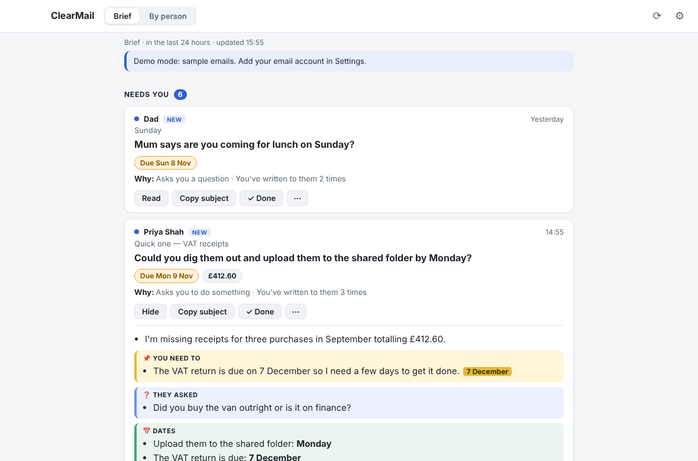

# ClearMail

**An inbox assistant for your Mac.** ClearMail sorts your email into **Needs you**, **Worth knowing** and **Noise**, says why in plain English, shows each email's deadline, and gives you a short version of every email. You can read the whole email and reply without leaving ClearMail. Once a day, a **morning brief** tells you how many emails need you.

ClearMail **reads** your email and **sends only the replies you write**. It can't delete, move or mark anything in your mailbox, and it has no AI: everything is worked out on your Mac. It works with Outlook and Microsoft 365 (including university and work accounts), Gmail, iCloud, Yahoo and most other email, and shows all your accounts in one place.



**Contents:** [What it does](#what-it-does) · [Download and install](#download-and-install) · [Add your email accounts](#add-your-email-accounts) · [The morning brief](#the-morning-brief) · [Using Outlook / Microsoft 365](#using-outlook--microsoft-365) · [Privacy and safety](#privacy-and-safety) · [Good to know](#good-to-know) · [Updating from version 0.2](#updating-from-version-02) · [For the repo owner](#for-the-repo-owner) · [For developers](#for-developers)

## What it does

### The Brief

The **Brief** tab is ClearMail's main screen. It sorts the email from all your accounts into four parts:

- **Needs you:** a person asking you a question or to do something, a deadline coming up (a tax return, a bill, a form to hand in), a payment due, an email you flagged in Outlook, or anyone you marked **Always important**. The most urgent come first: overdue, then the soonest deadline.
- **Worth knowing:** receipts, order updates, emails you're only copied (CC'd) on, emails you've already replied to, security alerts, newsletters you usually open, and deadlines further away. New ones since your last brief are at the top; older ones are under **Earlier**.
- **Noise** (folded away): promotions, newsletters you never open, old sign-in codes, and senders you chose **Always noise**. For example "7 hidden: 5 newsletters, 1 promotion, 1 old sign-in code". **Noise is only hidden, never deleted:** open it any time to read an email or click **Not noise**.
- **Done** (folded away): emails you've dealt with. Replying from ClearMail marks an email done. **Undo** puts it back.

Each email shows:

- who sent it, the subject, and **the short version in bold** (for example *"Please confirm you're happy to proceed by Friday 6th November"*)
- chips for **deadlines** (red if it's due within a day or overdue, amber within 3 days, "?" if ClearMail isn't sure of the date), **money**, **attachments** and **links**
- a **Why:** line, for example *"Why: Asks you to do something · You've written to them 6 times"*
- a **Careful** note when an email asks for a password, bank details or a payment and you've never written to the sender: check it's genuine by going to the company's own app or website, not a link in the email

The buttons on each email:

- **Read** opens the short version and the **full original email** (with a switch to the cleaned version) right there. Nothing the cleaner removed is out of reach.
- **Reply** opens a reply box. It always says which of your addresses the reply comes **from** and who it goes **to**. Press **Send** or **⌘↩** (a plain Enter just starts a new line). ClearMail then waits **5 seconds** and shows **Sending… Undo**, so you can change your mind. The reply goes to the sender (or the Reply-To address the email asks for), from the account the email was sent to.
- **✓ Done** moves it to Done (only in ClearMail; nothing changes in your mailbox).
- **⋯** has **Always important**, **Always noise**, and **Open in Outlook on the web** (Outlook accounts) or **Open in Mail** (other accounts).

### The short version

ClearMail removes the waffle: greetings, "hope you're well", "please be advised that", sign-offs, signatures, "Sent from my iPhone", quoted reply chains, legal disclaimers and unsubscribe footers. It rewrites wordy phrases ("in order to" becomes "to", "at your earliest convenience" becomes "as soon as you can") but never touches names, numbers, dates, amounts, links or the word "not". It then pulls out:

- 📌 **You need to**: things you have to do, with their deadlines
- ❓ **They asked**: questions waiting for your answer
- 📅 **Dates**: what is due and when

Each email says how much shorter it got, for example "Short version: 38 of 205 words".

### By person

The **By person** tab groups emails by sender, like a chat. Each email has a badge (Needs you, Worth knowing or Noise), and you can filter to one of them. The reply box works the same as in the Brief.

### How ClearMail decides

ClearMail sorts with rules, not AI. It looks at who the email is to (you, or only CC), whether it's from a mailing list or sent automatically, whether a person asks you something, the dates in it, whether you flagged it in Outlook, whether Outlook filed it under **Other**, how often you open that sender's emails, and **who you've written to** (from your Sent folder). An email only goes to Noise if it's clearly a newsletter, a promotion or automatic, or you chose Always noise for that sender. A person asking you something, a deadline, a payment due or someone you write to is never hidden.

It won't always be right. One click on **Always important**, **Always noise** or **Not noise** fixes a sender or an email, and ClearMail remembers it. Your rules are listed in **Settings** → **Sorting rules**, where you can remove them.

## Download and install

ClearMail runs on any Mac with Apple Silicon (M1 or later) or an Intel processor. One download works on both.

1. Open the [Releases page](https://github.com/willwright11/clearmail/releases/latest).
2. Under **Assets**, click **ClearMail-*version*-universal.dmg** (for example `ClearMail-0.3.0-universal.dmg`) to download it.
3. Open the downloaded file. In the window that appears, drag the **ClearMail** icon onto the **Applications** folder.
4. Eject the ClearMail disk (the ⏏ button next to it in Finder's sidebar). You can delete the .dmg file now.

### Opening it the first time

ClearMail is free and isn't sold through Apple, so it hasn't been checked ("notarised") by Apple. macOS blocks apps like this the first time. You only need to do this once:

1. Open your **Applications** folder and double-click **ClearMail**. macOS says **"ClearMail" Not Opened** (or that Apple could not verify it). Click **Done**. Don't click **Move to Bin** (or **Move to Trash**).
2. Click the Apple logo at the top left of the screen → **System Settings** → **Privacy & Security** (in the sidebar; you may need to scroll down).
3. Scroll down to **Security**. Next to the message about ClearMail being blocked, click **Open Anyway**. This button only appears for about an hour after step 1, so if it's missing, do step 1 again.
4. Enter your Mac login password (or use Touch ID) and click **OK**. If macOS asks once more, click **Open Anyway** (or **Open**).

From then on, ClearMail opens normally, like any other app. These steps are the same on macOS Sequoia (15), Tahoe (26) and later. On older versions you can instead Control-click ClearMail, choose **Open**, then click **Open**.

**If that doesn't work** (there's no **Open Anyway** button, or macOS says ClearMail "is damaged and can't be opened"), use Terminal once:

1. Open **Terminal** (Applications → Utilities → Terminal).
2. Copy this line, paste it into Terminal and press Return:
   ```bash
   xattr -dr com.apple.quarantine /Applications/ClearMail.app
   ```
   It removes the "downloaded from the internet" label from ClearMail only. Nothing is printed if it worked.
3. Close Terminal and open ClearMail again.

### "ClearMail wants to use your confidential information"

ClearMail protects your passwords and sign-ins with the macOS Keychain. Sometimes, especially after installing a new version, macOS asks whether ClearMail may use **"ClearMail Safe Storage"** in your keychain. Enter your Mac login password and click **Always Allow**. If you click **Deny**, ClearMail can't unlock what you saved: quit and reopen it and choose **Always Allow**, or sign in to your accounts again.

### Updating

Download the new .dmg from the [Releases page](https://github.com/willwright11/clearmail/releases/latest), drag ClearMail onto Applications again and choose **Replace**. Your accounts and settings are kept. (Updating from version 0.2? See [Updating from version 0.2](#updating-from-version-02).) You may need to do the [first-time steps](#opening-it-the-first-time) again for the new version.

## Add your email accounts

When ClearMail first opens it shows sample emails, so you can try it out. To use your own email, press **⌘,** (or click the ⚙︎ button) to open **Settings**.

Under **Accounts**:

- **＋ Add Outlook or Microsoft 365** is for Outlook.com, Hotmail, Live and MSN addresses, and for work or university Microsoft 365 accounts. See [Using Outlook / Microsoft 365](#using-outlook--microsoft-365) below. Once added, the account says **Can read and reply · can't delete or move ✓**.
- **＋ Add Gmail, iCloud, Yahoo or other** opens a form:
  1. Choose your provider (Gmail, iCloud, Yahoo, or **Other** for any email service that offers IMAP and SMTP with SSL/TLS or STARTTLS). For **Other**, also enter the outgoing (SMTP) server: ClearMail sends your replies through it.
  2. Enter your email address and an **app password**. This is not your normal password:
     - **Gmail:** turn on 2-Step Verification, then create one at <https://myaccount.google.com/apppasswords>
     - **iCloud:** <https://account.apple.com> → Sign-In and Security → App-Specific Passwords
     - **Yahoo:** Account Security → Generate app password
     - **Other:** use your full email address as the user name, as it is also the From address of your replies.

You can add as many accounts as you like. Each one is listed with its status. If an account has a problem, the reason is shown next to it and at the top of the Brief (which keeps that account's emails from the last time it loaded), and Outlook accounts get a **Sign in again** button when Microsoft needs you to sign in again. One account having a problem never stops the others loading. Use **Edit** or **Remove** to change or remove an account. Removing an account only removes it from ClearMail: nothing is deleted from the mailbox.

Under **General**:

- **Emails to load from each account:** the newest 60 by default, up to 500.
- **Demo mode:** shows sample emails instead of yours. Turn it off to see your own email.
- **Advanced** has the Microsoft app ID and **What ClearMail can see**: counts only, for example "60 emails, 41 with mailing-list headers, Focused/Other available, 312 people in Sent history".

Click **Save**. Settings stays open so you can check the result; click **Close** when you're done.

## The morning brief

Once a day, at a time you choose, ClearMail checks your email and shows one notification, for example:

> **Morning brief**
> 2 need you · 5 worth knowing · 23 noise hidden

Click it to open the Brief. The notification only has numbers: it never shows names or subjects, because it can appear on your lock screen. If an account couldn't be checked, it says so (for example "Couldn't check you@uni.ac.uk").

To turn it on, open **Settings** → **Morning brief**:

1. Tick **Send me a morning brief**, choose the **time** and the **days**, and click **Save**. **Next brief** shows when the next one comes.
2. Click **Send a test brief now**. The first time, macOS asks whether ClearMail may show notifications: click **Allow**. If no notification appears, ClearMail shows a button to open **System Settings** → **Notifications** → **ClearMail**, where you can turn them on.
3. Optional: tick **Open ClearMail when I log in to my Mac**, so the brief still comes after a restart. ClearMail then starts without a window (click its Dock icon to open it). macOS may ask you to approve it in **System Settings** → **General** → **Login Items**; ClearMail shows a button for that. Because ClearMail isn't notarised by Apple, macOS sometimes doesn't accept it at all. If ClearMail says so, add it yourself: **System Settings** → **General** → **Login Items** → **＋** → choose **ClearMail** in Applications.

Good to know:

- **ClearMail must be running.** Closing the window is fine; quitting with **⌘Q** stops the brief until you open ClearMail again.
- **Notifications only work in the downloaded app**, not when a developer runs it with `npm start`.
- If your Mac is asleep or offline at the brief time, the brief comes when it wakes up or reconnects: until 6 pm, or 6 hours after your brief time if that's later (never after midnight). Otherwise that day is skipped.
- It waits while the screen is locked, so it's there when you unlock.
- If it can't check your email, it tries again every 5 minutes. After 3 tries it says "Couldn't check your email. Open ClearMail to try again."
- Turning it on after today's time has passed starts it tomorrow. There's never more than one brief a day.
- In demo mode the brief is paused (the test button still works).
- "New" in the brief means new since the last brief (or the last 24 hours if there wasn't one).

## Using Outlook / Microsoft 365

Microsoft has switched off app passwords for Outlook, so ClearMail signs in the modern way: it opens Microsoft's own sign-in page in your web browser, you sign in there, and Microsoft gives ClearMail permission to **read your email and send the replies you write**. ClearMail never sees your Microsoft password, and it never asks for permission to change your mailbox.

Microsoft only lets an app do this if the app has an **Application (client) ID**, a free ID you get by registering the app with Microsoft. If your copy of ClearMail came with one built in, ClearMail goes straight to the sign-in page and you can [skip to step 3](#step-3-sign-in-from-clearmail). Otherwise ClearMail shows **One-time setup for Outlook** and asks for the ID. Getting one takes about 5 minutes and you only do it once. The same ID works for all your Microsoft accounts.

### Step 1: Get a free Microsoft "directory" (personal accounts only)

Microsoft only lets you register apps inside a *directory* (also called a *tenant*). A personal Outlook.com, Hotmail or Live account doesn't come with one. If you try without one, Microsoft says *"The ability to create applications outside of a directory has been deprecated"*.

Pick one of these to get a directory, signing in with your **personal** Microsoft account (for example `you@outlook.com`):

- **Azure for Students** (full-time university students): <https://azure.microsoft.com/free/students>. No credit card needed. Microsoft checks you're a student using your university email address.
- **A free Azure account** (anyone): <https://azure.microsoft.com/pricing/purchase-options/azure-account>, then choose the free account. Microsoft asks for a phone number and a credit or debit card **to check you're a real person**. It says it won't charge you unless you choose to upgrade to pay-as-you-go, though you may see a temporary hold of about $1 (or equivalent) that is then released.

Either one creates a directory called **Default Directory** for you. Registering an app is free, and you don't need to use any other Azure service. When the free trial or credit ends, Azure switches off its paid services but doesn't delete your directory or the app registration, so you shouldn't need to upgrade or pay to keep using ClearMail.

If you already manage a directory (for example for a small business), you can use that instead. Signing in with a university or work account may also let you register apps in your organisation's directory, but many organisations switch that off, and a directory of your own is simpler.

### Step 2: Register ClearMail with Microsoft

1. Go to <https://entra.microsoft.com> (the **Microsoft Entra admin center**) and sign in with the account from step 1. The Azure portal at <https://portal.azure.com> works too: search for **App registrations** at the top.
2. If you have more than one directory, click the **Settings** (gear) icon at the top and switch to **Default Directory** (the one you made in step 1).
3. In the menu on the left, open **Entra ID** → **App registrations** (on some screens it's **Identity** → **Applications** → **App registrations**). Click **＋ New registration**.
4. **Name:** type `ClearMail`.
5. **Supported account types:** choose **Any Entra ID Tenant + Personal Microsoft accounts**. (On older screens it's called *Accounts in any organizational directory and personal Microsoft accounts*.) Don't leave it on **Single tenant only**: that stops Outlook.com accounts signing in.
6. **Redirect URI:** in **Select a platform**, choose **Public client/native (mobile & desktop)**. In the box next to it, type exactly `http://localhost` (no port number, no slash at the end). Don't choose **Web** or **Single-page application (SPA)**.
7. Click **Register**.
8. On the **Overview** page that opens, find **Application (client) ID** and click the copy button next to it. It looks like `1a2b3c4d-1234-5678-9abc-1234567890ab`. (Not the *Directory (tenant) ID* or *Object ID*.)
9. Give the app its permissions. In the left menu, click **API permissions** → **＋ Add a permission** → **Microsoft Graph** → **Delegated permissions**. Use the search box to find and tick each of these:
   - **offline_access** (under *OpenId permissions*): lets ClearMail stay signed in
   - **Mail.Read**: read your email
   - **Mail.Send**: send the replies you write
   - **User.Read** is already there: your name and email address

   Click **Add permissions**. **Don't add Mail.ReadWrite**: that permission would let an app mark emails as read, move or delete them, and ClearMail doesn't need it. (If you set ClearMail up before version 0.3 and Mail.ReadWrite is in the list, click **⋯** next to it → **Remove permission**.) You don't need **Grant admin consent**: you approve the permissions yourself the first time you sign in. You also don't need a client secret or certificate.

**Forgot the redirect URI in step 6?** Open the app registration, click **Authentication** in the left menu, then **Add a platform** (or **Add redirect URI**) → **Mobile and desktop applications**, enter `http://localhost` and save. If it's missing, Microsoft's sign-in page shows error **AADSTS50011** instead of returning to ClearMail.

### Step 3: Sign in from ClearMail

1. In ClearMail, press **⌘,** and click **＋ Add Outlook or Microsoft 365**.
2. If ClearMail shows **One-time setup for Outlook**, paste the **Application (client) ID** and click **Save and sign in**. (You can change it later under **General** → **Advanced**.)
3. Your web browser opens Microsoft's sign-in page, and ClearMail shows "Finish signing in in your browser…". Choose your account, or **Use another account**.
4. Microsoft lists what ClearMail is asking for (read your mail, send mail as you, keep access, view your basic profile) and may label it **unverified**. That's expected: it's the app you registered yourself. Click **Accept**.
5. When the browser says **You're signed in**, close the tab and go back to ClearMail. Your account is added and shows **Can read and reply · can't delete or move ✓**. Its email loads when you close Settings.

To add another Microsoft account (for example your university one), click **＋ Add Outlook or Microsoft 365** again and choose **Use another account** in the browser.

**Staying signed in:** Microsoft keeps ClearMail signed in as long as you open it at least once every 90 days. Changing your Microsoft password, or your organisation's IT team, can also sign it out. When that happens the account shows **Sign in again**: click it and sign in in your browser.

### University and work accounts

University and work accounts use the same steps and the same ID. However, your organisation decides which apps may read its email. Many universities only allow apps from Microsoft-verified publishers, or none at all. If so, Microsoft shows **Need admin approval** or **Approval required** in the browser. If you click **Back to app**, ClearMail says signing in didn't finish and points you here.

- **Ask your IT team, if you want to.** If the Microsoft page has a **Request approval** box, you can use it. Be aware that the app registration lives in *your own* directory, so many IT teams will (reasonably) say no. If you ask, ask them to approve ClearMail **for your account only**, and tell them it only asks to read mail and send replies. Don't ask for organisation-wide consent ("Grant admin consent for …"): that would let whoever controls your directory request access to everyone's mailbox.
- **Otherwise, keep reading that mailbox in Outlook** and use ClearMail for your other accounts.

### If something goes wrong

| What you see | What to do |
|---|---|
| *Selected user account does not exist in tenant 'Microsoft Services'*, or *The ability to create applications outside of a directory has been deprecated* | Your personal account doesn't have a directory yet: see [step 1](#step-1-get-a-free-microsoft-directory-personal-accounts-only). Do it in a private/incognito browser window, and afterwards switch to **Default Directory** (step 2.2). |
| Microsoft's page shows **AADSTS700016** (app not found) | The app ID is wrong, or the app doesn't allow your kind of account. Click **Cancel** in ClearMail, copy the **Application (client) ID** from the app's **Overview** page again (under **General** → **Advanced** in ClearMail's Settings), and check the app's **Supported account types** include personal Microsoft accounts as well as work and school accounts. |
| Microsoft's page shows **AADSTS50011** (redirect URI mismatch) | Click **Cancel** in ClearMail and add `http://localhost` under **Mobile and desktop applications** (see *Forgot the redirect URI* above). |
| ClearMail says Microsoft treated it as a website or a web page app | `http://localhost` is listed under **Web** or **Single-page application**. Remove it from there and add it under **Mobile and desktop applications**. |
| **Need admin approval** / **Approval required** | Your organisation has to approve ClearMail: see [University and work accounts](#university-and-work-accounts). |
| The account shows **Sign in again** | Click it and sign in in your browser. |
| The account says **ClearMail no longer needs permission to change your mailbox. Click Sign in again.** | You set it up with ClearMail 0.2, which asked for more than it now needs. Click **Sign in again**. See [Updating from version 0.2](#updating-from-version-02). |
| The account says Microsoft **still lets ClearMail change this mailbox, because of an old permission** | ClearMail never uses it, but you can take it back: click **Open Microsoft's permissions page**, remove ClearMail there, then click **Sign in again**. |
| An old **Outlook** account from an earlier ClearMail version shows an error about app passwords | Outlook no longer works with app passwords. Remove that account in Settings and use **＋ Add Outlook or Microsoft 365**. |

## Privacy and safety

- **No AI, no ClearMail server.** Sorting, short versions and deadlines are all worked out on your Mac. ClearMail only talks to your own email providers (Microsoft, Google, Apple, Yahoo or your mail server). Nothing is sent to anyone else.
- **ClearMail never changes your mailbox.** It can't delete, move, flag or mark anything as read:
  - **Outlook:** ClearMail only asks Microsoft for permission to read mail and send mail (plus to stay signed in and read your name and address). It has no permission to change anything, and its code refuses to send any request that would. You can take its permission back at any time: for personal accounts at <https://account.live.com/consent/Manage>, for work or university accounts in the My Apps portal at <https://myapps.microsoft.com>.
  - **Gmail, iCloud, Yahoo and others:** ClearMail opens your inbox read-only, so reading never marks anything as read. The only thing it ever adds is a copy of a reply you sent, in your Sent folder.
- **Replies only when you press Send.** ClearMail never writes or sends anything by itself. Each reply waits 5 seconds so you can **Undo** it, and quitting ClearMail during those 5 seconds means it isn't sent. A reply only goes to the person who emailed you (or the Reply-To address their email gives), from the account the email was sent to, and the From/To line in the reply box always shows both.
- **Your passwords and Microsoft sign-ins** are encrypted with the macOS Keychain and stored only on your Mac.
- **What ClearMail keeps on your Mac:** your settings, your sorting rules and Done marks, and a list of the addresses you've sent email to with how many times (from your Sent folder, so it knows who you know). These files can only be read by your Mac user account. ClearMail doesn't keep the text of your emails on disk.
- **Email HTML is never displayed.** It's converted to plain text, so tracking pixels and remote images never load. The page runs sandboxed with a strict Content Security Policy. Links open in your browser only after you confirm.
- ClearMail loads the newest 60 messages in each account's inbox (**Emails to load from each account** in Settings, up to 500).
- **Replies are filed in Sent:** Outlook replies are sent by Outlook itself, so they're threaded properly and saved in your **Sent Items**. Other accounts send over SMTP; for iCloud and custom servers a copy is also saved in your Sent folder (Gmail and Yahoo do this themselves).

## Keyboard shortcuts

| Key | Action |
|---|---|
| ⌘1 / ⌘2 | Brief / By person |
| ⌘↩ | send a reply (Enter starts a new line) |
| Esc | close the reply box (your draft is kept) or the ⋯ menu |
| ⌘R | check for new email |
| ⌘F | search (By person) |
| ↑ / ↓ | previous / next person (By person) |
| ⌘, | settings |

## Good to know

- **Emails stay unread in Outlook.** Reading or replying in ClearMail doesn't mark anything as read in Outlook (or Gmail and the rest), because ClearMail deliberately has no permission to change your mailbox. ClearMail shows each email's unread dot as Outlook has it.
- **Outlook for Mac can't be opened at a particular email by another app.** **Open in Outlook on the web** in the ⋯ menu is the fallback: it opens that email in your browser.
- **Sorting is rule-based**, so now and then a cold sales email will land in Needs you. One click on **Always noise** fixes that sender for good.
- **Gmail and iCloud app passwords can't be limited** to reading and sending: an app password gives full access to the mailbox. ClearMail's own code only reads, and only sends when you reply, but keep app passwords private and delete any you no longer use (from the same page you made them on).
- **Mailing-list information on Outlook.com:** ClearMail asks Microsoft for each email's mailing-list headers to recognise newsletters. If Microsoft doesn't provide them for your account, newsletters are recognised by their wording instead. **Settings** → **General** → **Advanced** → **What ClearMail can see** shows how many emails had them.
- **Done, Always important, Always noise and Not noise live in ClearMail only.** They don't change anything in your mailbox, and they don't follow you to Outlook on your phone.

## Updating from version 0.2

Version 0.3 is a big change: ClearMail is now an inbox assistant that reads and replies, without AI. When you first open it:

- **Outlook and Microsoft 365 accounts ask you to sign in again.** Version 0.2 asked Microsoft for permission to change your mailbox (to mark emails as read). 0.3 doesn't need it, so the old sign-in is deleted and the account says *"ClearMail no longer needs permission to change your mailbox. Click Sign in again."* Click **Sign in again** and accept. If you registered your own app ID, also replace **Mail.ReadWrite** with **Mail.Read** in its API permissions (see [step 2.9](#step-2-register-clearmail-with-microsoft)).
- If the account then says Microsoft **still lets ClearMail change this mailbox**, Microsoft is remembering what you agreed to for 0.2. Click **Open Microsoft's permissions page**, remove ClearMail, and click **Sign in again**.
- **Your Claude API key and the saved AI summaries are deleted.** ClearMail no longer uses AI. You can delete the key itself at <https://console.anthropic.com> if you don't use it elsewhere.
- **Gmail, iCloud, Yahoo and other accounts keep working** with their saved app passwords and outgoing (SMTP) servers.
- Emails you marked **Done** in 0.2 stay done.

## For the repo owner

The Mac app is built by GitHub Actions ([`.github/workflows/build-mac.yml`](.github/workflows/build-mac.yml)) on a GitHub-hosted Mac, so nobody needs to install developer tools. Each build runs the tests, then makes one universal .dmg (Intel + Apple Silicon) that is ad-hoc signed (so it runs on Apple Silicon) but not notarised.

### Publish a new version

1. On GitHub, edit `package.json` and change `"version"` (for example to `"0.4.0"`). Commit the change to `main`.
2. Go to **Actions** → **Build Mac app** → **Run workflow**, leave **Also publish a GitHub Release** ticked, and click **Run workflow**.
3. After about 10 minutes the release **ClearMail v0.4.0** appears under **Releases**, with **ClearMail-0.4.0-universal.dmg** attached and its SHA-256 in the notes. GitHub creates the `v0.4.0` tag itself. Running it again for the same version replaces the .dmg.

Pushing a tag yourself (`git tag v0.4.0 && git push origin v0.4.0`) does the same; the build stops if the tag doesn't match `package.json`.

To build without publishing, untick **Also publish a GitHub Release** in step 2. When it finishes, the .dmg is under **Artifacts** at the bottom of the run's page (as a zip; you must be signed in to GitHub to download it).

### Build your Microsoft app ID into the download (optional)

If you do this, people who download ClearMail can add Outlook accounts without registering their own app (they skip straight to [step 3](#step-3-sign-in-from-clearmail)):

1. Register the app as in [Using Outlook / Microsoft 365](#using-outlook--microsoft-365) and copy its **Application (client) ID**.
2. In this repository on GitHub: **Settings** → **Secrets and variables** → **Actions** → **Variables** tab → **New repository variable**.
3. **Name:** `MS_CLIENT_ID`. **Value:** the Application (client) ID. Click **Add variable**.
4. Publish a new version (or run the workflow). Builds from now on include the ID.

The ID isn't a password: it's in every copy of the app and only identifies it to Microsoft. It's a *variable*, not a *secret*, so you can see it in the build log. Anyone using that build signs in through your app registration, but each person can only reach their own mailbox, and only after they approve it. Someone can still use their own ID by entering it under **General** → **Advanced** in Settings.

## For developers

You need [Node.js](https://nodejs.org) 22.12 or newer.

```bash
git clone https://github.com/willwright11/clearmail.git
cd clearmail
npm install
npm run demo     # try it with sample emails
npm start        # normal start (opens in demo mode until you add an account)
npm test         # unit and integration tests (no network, no Electron window)
npm run dist     # on a Mac: builds dist/ClearMail-<version>-universal.dmg
```

To use a Microsoft app ID while developing, either start with `CLEARMAIL_MS_CLIENT_ID=<id> npm start`, enter it in Settings, or create `build-config.json` (ignored by git) containing `{ "msClientId": "<id>" }` before `npm run dist`. Notifications (the morning brief) only appear in the signed app built by `npm run dist`, not with `npm start`.

Packaging is configured in the `build` section of `package.json` (electron-builder). `mac.identity` is `"-"` (ad-hoc signing, so the app runs on Apple Silicon without an Apple Developer account). The hardened runtime is on, and Electron's `runAsNode`, `NODE_OPTIONS` and `--inspect` fuses are off, so other programs can't start ClearMail in a mode that runs their own code with ClearMail's Keychain access. To notarise, you'd need a Developer ID certificate, then set `identity` and supply the notarisation credentials.

```
main.js                  Electron main process: window, accounts, IPC, the 5-second reply queue,
                         the morning brief (notifications, login item), loading and sorting
preload.js               the safe bridge the UI uses (no Node access in the page)
src/view.js              emails -> the Brief: cleans, finds deadlines, shortens, sorts (BriefView)
src/triage.js            the sorting rules: Needs you / Worth knowing / Noise, with reasons
src/dates.js             finds dates and deadlines ("by Friday", "within 28 days")
src/cleaner.js           offline waffle remover + extraction of money, asks, links
src/summarize.js         the short version (phrase tightening with meaning guards)
src/brief.js             when the morning brief is due, its text, and its scheduler
src/history.js           who you've written to and what you've replied to (from Sent)
src/mail.js              IMAP read-only (imapflow + mailparser), SMTP reply (nodemailer)
src/microsoft.js         Outlook / Microsoft 365: OAuth sign-in (PKCE, loopback) and Microsoft Graph,
                         with a guard that refuses any request except reads and replies
src/store.js             settings.json (Keychain-encrypted secrets), state.json, history.json
src/config.js            settings built in at packaging time (build-config.json)
src/demo.js              sample inbox (dates worked out from today); src/demo-sent.js its Sent folder
renderer/                the UI: common.js, brief.js, people.js, settings.js, app.js (plain HTML/CSS/JS)
build/                   app icon
.github/workflows/       GitHub Actions: build the .dmg and publish releases
test/                    npm test; test/no-changes.test.js guards that nothing can change a mailbox
```

## Ideas for next steps

- Gmail sign-in with Google (read and send permissions only) instead of app passwords
- Live updates (IMAP IDLE, Microsoft Graph change notifications) instead of checking on refresh and at brief time
- Show both sides of a conversation in By person, from the Sent folder
- Let the user teach ClearMail a deadline it missed, or say "not a deadline"
