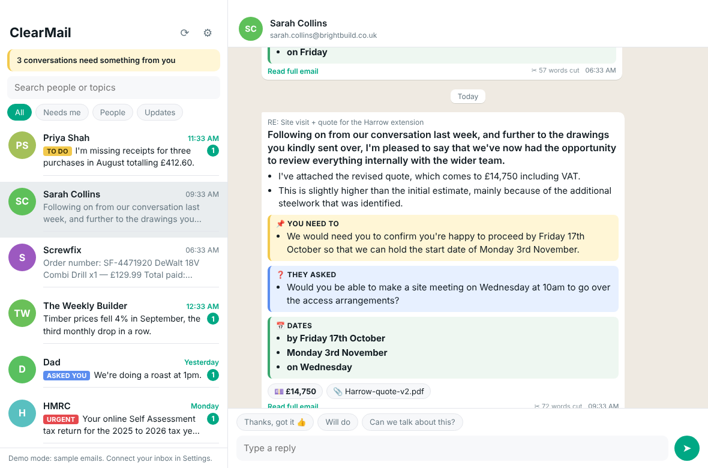

# ClearMail

**Email that reads like WhatsApp.** A Mac app that strips the waffle out of your emails and shows each one as a short chat message, with the parts you must not miss highlighted. It works with Outlook and Microsoft 365 (including university and work accounts), Gmail, iCloud, Yahoo and most other email, and shows all your accounts in one chat list.



**Contents:** [What it does](#what-it-does) · [Download and install](#download-and-install) · [Add your email accounts](#add-your-email-accounts) · [Using Outlook / Microsoft 365](#using-outlook--microsoft-365) · [Privacy and safety](#privacy-and-safety) · [For the repo owner](#for-the-repo-owner) · [For developers](#for-developers)

## What it does

- **All your accounts, one chat list.** Add as many accounts as you like, for example a personal Outlook.com address and a university Microsoft 365 address. Emails are grouped by person, newest first, with unread badges. When you have more than one account, each message shows which of your addresses it was sent to.
- **Waffle removed.** Strips greetings, "hope you're well", "don't hesitate to contact me", sign-offs, signatures, "Sent from my iPhone", quoted reply chains, legal disclaimers and unsubscribe footers. Each bubble shows how many words were cut.
- **Key info pulled out**, so nothing gets lost in a paragraph:
  - 📌 **You need to**: things you have to do, with deadlines
  - ❓ **They asked**: questions waiting for your answer
  - 📅 **Dates**, 💷 **money**, 📎 **attachments**, 🔗 **links** (long tracking links become short labels)
  - ⚠︎ **Time-sensitive** emails get a red edge
- **"Needs me" filter** and a banner showing how many conversations are waiting on you. **Updates** collects receipts, newsletters and automated mail so they don't bury real people.
- **Reply like a text.** Tap a suggested reply or type your own, press Enter, and it's sent as a proper email reply from the account the email was sent to (ClearMail shows "Replying from ..." so you always know which).
- **Read full email** on any bubble shows the original, uncleaned email (with a switch to the cleaned version), so nothing the cleaner removed is out of reach.
- **Mark done** clears an email's "needs me" flag once you've dealt with it.

### Two modes

| | Offline (default) | AI (add a Claude API key) |
|---|---|---|
| Removes waffle, signatures, quoted replies, footers | ✅ | ✅ |
| Highlights dates, money, links, attachments | ✅ | ✅ |
| One-line headline per email | first useful sentence | rewritten in plain English |
| To-do list and questions | pattern-based | understood and reworded |
| Suggested replies | generic | written for that email |

Offline mode runs entirely on your Mac. AI mode sends each email to Claude (Anthropic's API): the sender, subject, date and attachment names, the cleaned text, and the original text (up to 30,000 characters, including any quoted or forwarded messages), so nothing the cleaner dropped is missed. The result is cached, so each email is only summarised once.

## Download and install

ClearMail runs on any Mac with Apple Silicon (M1 or later) or an Intel processor. One download works on both.

1. Open the [Releases page](https://github.com/willwright11/clearmail/releases/latest).
2. Under **Assets**, click **ClearMail-*version*-universal.dmg** (for example `ClearMail-0.1.0-universal.dmg`) to download it.
3. Open the downloaded file. In the window that appears, drag the **ClearMail** icon onto the **Applications** folder.
4. Eject the ClearMail disk (the ⏏ button next to it in Finder's sidebar). You can delete the .dmg file now.

### Opening it the first time

ClearMail is free and isn't sold through Apple, so it hasn't been checked ("notarised") by Apple. macOS blocks apps like this the first time. You only need to do this once:

1. Open your **Applications** folder and double-click **ClearMail**. macOS says **"ClearMail" Not Opened** (or that Apple could not verify it). Click **Done**. Don't click **Move to Bin** (or **Move to Trash**).
2. Click the Apple logo at the top left of the screen → **System Settings** → **Privacy & Security** (in the sidebar; you may need to scroll down).
3. Scroll down to **Security**. Next to the message about ClearMail being blocked, click **Open Anyway**. This button only appears for about an hour after step 1, so if it's missing, do step 1 again.
4. Enter your Mac login password (or use Touch ID) and click **OK**. If macOS asks once more, click **Open Anyway** (or **Open**).

From then on, ClearMail opens normally, like any other app. These steps are the same on macOS Sequoia (15), Tahoe (26) and later. On older versions you can instead Control-click ClearMail, choose **Open**, then click **Open**.

**If that doesn't work** (there's no **Open Anyway** button, or macOS says ClearMail "is damaged and can't be opened"), use Terminal once:

1. Open **Terminal** (Applications → Utilities → Terminal).
2. Copy this line, paste it into Terminal and press Return:
   ```bash
   xattr -dr com.apple.quarantine /Applications/ClearMail.app
   ```
   It removes the "downloaded from the internet" label from ClearMail only. Nothing is printed if it worked.
3. Close Terminal and open ClearMail again.

### "ClearMail wants to use your confidential information"

ClearMail protects your passwords and sign-ins with the macOS Keychain. Sometimes, especially after installing a new version, macOS asks whether ClearMail may use **"ClearMail Safe Storage"** in your keychain. Enter your Mac login password and click **Always Allow**. If you click **Deny**, ClearMail can't unlock what you saved: quit and reopen it and choose **Always Allow**, or sign in to your accounts again.

### Updating

Download the new .dmg from the [Releases page](https://github.com/willwright11/clearmail/releases/latest), drag ClearMail onto Applications again and choose **Replace**. Your accounts and settings are kept. You may need to do the [first-time steps](#opening-it-the-first-time) again for the new version.

## Add your email accounts

When ClearMail first opens it shows sample emails, so you can try it out. To use your own email, press **⌘,** (or click the ⚙︎ button) to open **Settings**.

Under **Accounts**:

- **＋ Add Outlook or Microsoft 365** is for Outlook.com, Hotmail, Live and MSN addresses, and for work or university Microsoft 365 accounts. See [Using Outlook / Microsoft 365](#using-outlook--microsoft-365) below.
- **＋ Add Gmail, iCloud, Yahoo or other** opens a form:
  1. Choose your provider (Gmail, iCloud, Yahoo, or **Other** for any email service that offers IMAP and SMTP with SSL/TLS or STARTTLS).
  2. Enter your email address and an **app password**. This is not your normal password:
     - **Gmail:** turn on 2-Step Verification, then create one at <https://myaccount.google.com/apppasswords>
     - **iCloud:** <https://account.apple.com> → Sign-In and Security → App-Specific Passwords
     - **Yahoo:** Account Security → Generate app password
     - **Other:** use your full email address as the user name, as it is also the From address of your replies.

You can add as many accounts as you like. Each one is listed with its status. If an account has a problem, the reason is shown next to it, and Outlook accounts get a **Sign in again** button when Microsoft needs you to sign in again. Use **Edit** or **Remove** to change or remove an account.

Under **General**:

- **Claude API key (optional):** paste a key from <https://console.anthropic.com> for the AI summaries described above.
- **Emails to load from each account:** the newest 60 by default, up to 500.
- **Demo mode:** shows sample emails instead of yours. Turn it off to see your own email.

Click **Save & reload** when you're done.

## Using Outlook / Microsoft 365

Microsoft has switched off app passwords for Outlook, so ClearMail signs in the modern way: it opens Microsoft's own sign-in page in your web browser, you sign in there, and Microsoft gives ClearMail permission to read and send your email. ClearMail never sees your Microsoft password.

Microsoft only lets an app do this if the app has an **Application (client) ID**, a free ID you get by registering the app with Microsoft. If your copy of ClearMail came with one built in, ClearMail goes straight to the sign-in page and you can [skip to step 3](#step-3-sign-in-from-clearmail). Otherwise ClearMail shows **One-time setup for Outlook** and asks for the ID. Getting one takes about 5 minutes and you only do it once. The same ID works for all your Microsoft accounts.

### Step 1: Get a free Microsoft "directory" (personal accounts only)

Microsoft only lets you register apps inside a *directory* (also called a *tenant*). A personal Outlook.com, Hotmail or Live account doesn't come with one. If you try without one, Microsoft says *"The ability to create applications outside of a directory has been deprecated"*.

Pick one of these to get a directory, signing in with your **personal** Microsoft account (for example `you@outlook.com`):

- **Azure for Students** (full-time university students): <https://azure.microsoft.com/free/students>. No credit card needed. Microsoft checks you're a student using your university email address.
- **A free Azure account** (anyone): <https://azure.microsoft.com/pricing/purchase-options/azure-account>, then choose the free account. Microsoft asks for a phone number and a credit or debit card **to check you're a real person**. It says it won't charge you unless you choose to upgrade to pay-as-you-go, though you may see a temporary hold of about $1 (or equivalent) that is then released.

Either one creates a directory called **Default Directory** for you. Registering an app is free, and you don't need to use any other Azure service. When the free trial or credit ends, Azure switches off its paid services but doesn't delete your directory or the app registration, so you shouldn't need to upgrade or pay to keep using ClearMail.

If you already manage a directory (for example for a small business), you can use that instead. Signing in with a university or work account may also let you register apps in your organisation's directory, but many organisations switch that off, and a directory of your own is simpler.

### Step 2: Register ClearMail with Microsoft

1. Go to <https://entra.microsoft.com> (the **Microsoft Entra admin center**) and sign in with the account from step 1. The Azure portal at <https://portal.azure.com> works too: search for **App registrations** at the top.
2. If you have more than one directory, click the **Settings** (gear) icon at the top and switch to **Default Directory** (the one you made in step 1).
3. In the menu on the left, open **Entra ID** → **App registrations** (on some screens it's **Identity** → **Applications** → **App registrations**). Click **＋ New registration**.
4. **Name:** type `ClearMail`.
5. **Supported account types:** choose **Any Entra ID Tenant + Personal Microsoft accounts**. (On older screens it's called *Accounts in any organizational directory and personal Microsoft accounts*.) Don't leave it on **Single tenant only**: that stops Outlook.com accounts signing in.
6. **Redirect URI:** in **Select a platform**, choose **Public client/native (mobile & desktop)**. In the box next to it, type exactly `http://localhost` (no port number, no slash at the end). Don't choose **Web** or **Single-page application (SPA)**.
7. Click **Register**.
8. On the **Overview** page that opens, find **Application (client) ID** and click the copy button next to it. It looks like `1a2b3c4d-1234-5678-9abc-1234567890ab`. (Not the *Directory (tenant) ID* or *Object ID*.)
9. Give the app its permissions. In the left menu, click **API permissions** → **＋ Add a permission** → **Microsoft Graph** → **Delegated permissions**. Use the search box to find and tick each of these:
   - **offline_access** (under *OpenId permissions*): lets ClearMail stay signed in
   - **Mail.ReadWrite**: read your inbox and mark emails as read
   - **Mail.Send**: send your replies
   - **User.Read** is already there: your name and email address

   Click **Add permissions**. You don't need **Grant admin consent**: you approve the permissions yourself the first time you sign in. You also don't need a client secret or certificate.

**Forgot the redirect URI in step 6?** Open the app registration, click **Authentication** in the left menu, then **Add a platform** (or **Add redirect URI**) → **Mobile and desktop applications**, enter `http://localhost` and save. ClearMail tells you if this is missing.

### Step 3: Sign in from ClearMail

1. In ClearMail, press **⌘,** and click **＋ Add Outlook or Microsoft 365**.
2. If ClearMail shows **One-time setup for Outlook**, paste the **Application (client) ID** and click **Save and sign in**. (You can change it later under **General** → **Advanced**.)
3. Your web browser opens Microsoft's sign-in page, and ClearMail shows "Finish signing in in your browser…". Choose your account, or **Use another account**.
4. Microsoft lists what ClearMail is asking for and may label it **unverified**. That's expected: it's the app you registered yourself. Click **Accept**.
5. When the browser says **You're signed in**, close the tab and go back to ClearMail. Your account is added and its email loads.

To add another Microsoft account (for example your university one), click **＋ Add Outlook or Microsoft 365** again and choose **Use another account** in the browser.

**Staying signed in:** Microsoft keeps ClearMail signed in as long as you open it at least once every 90 days. Changing your Microsoft password, or your organisation's IT team, can also sign it out. When that happens the account shows **Sign in again**: click it and sign in in your browser.

### University and work accounts

University and work accounts use the same steps and the same ID. However, your organisation decides which apps may read its email. Many universities only allow apps from Microsoft-verified publishers, or none at all. If so, Microsoft shows **Need admin approval** in the browser and ClearMail explains that your organisation has to approve it. You have two options:

- **Ask your IT team to approve it.** If the Microsoft page has a **Request approval** box, use it. Otherwise send IT your Application (client) ID and the permissions it needs (User.Read, Mail.ReadWrite, Mail.Send and offline_access, all *delegated*), and ask them to grant consent for it.
- **Forward your university email to your personal Outlook account** and read it there:
  1. Sign in to Outlook on the web (<https://outlook.office.com>) with your university account.
  2. Click **Settings** (gear icon) → **Mail** → **Forwarding**.
  3. Turn on **Enable forwarding**, enter your personal address, tick **Keep a copy of forwarded messages**, and click **Save**.

  Your university emails then appear in ClearMail under your personal account. Replies will come from your personal address, not your university one. Some organisations block forwarding to outside addresses: if forwarded emails never arrive, ask your IT team.

### If something goes wrong

| What you see | What to do |
|---|---|
| *The ability to create applications outside of a directory has been deprecated* | You need a directory first: see [step 1](#step-1-get-a-free-microsoft-directory-personal-accounts-only). |
| ClearMail says Microsoft doesn't recognise the app ID | Copy the **Application (client) ID** from the app's **Overview** page again, and check the app's **Supported account types** (on its Overview page) include personal Microsoft accounts as well as work and school accounts. |
| ClearMail says the redirect URI is missing, or Microsoft treated ClearMail as a website | Add `http://localhost` under **Mobile and desktop applications** (see *Forgot the redirect URI* above). If it's listed under **Web** or **Single-page application**, remove it from there. |
| **Need admin approval** | Your organisation has to approve ClearMail: see [University and work accounts](#university-and-work-accounts). |
| The account shows **Sign in again** | Click it and sign in in your browser. |

## Privacy and safety

- **Your passwords, Microsoft sign-ins and Claude API key** are encrypted with the macOS Keychain and stored only on your Mac.
- **Outlook:** ClearMail never sees your Microsoft password. It talks directly to Microsoft (no ClearMail server in between) and asks only to read and update your mail (to mark emails as read), send mail, stay signed in, and read your name and address. You can take this permission back at any time: for personal accounts at <https://account.live.com/consent/Manage>, for work or university accounts in the My Apps portal at <https://myapps.microsoft.com>.
- **Email HTML is never displayed.** It's converted to plain text, so tracking pixels and remote images never load. The page runs sandboxed with a strict Content Security Policy. Links open in your browser only after you confirm.
- ClearMail loads the newest 60 messages in each account's inbox (**Emails to load from each account** in Settings, up to 500). Opening a conversation marks its emails as read on the server.
- **Replies:** Outlook replies are sent by Outlook itself, so they're threaded properly and saved in your **Sent Items**. Other accounts send over SMTP; for iCloud and custom servers a copy is also saved in your Sent mailbox (Gmail and Yahoo do this themselves).

## Keyboard shortcuts

| Key | Action |
|---|---|
| ↑ / ↓ | previous / next conversation |
| Enter | send reply (Shift+Enter for a new line) |
| ⌘R | refresh inbox |
| ⌘F | search |
| ⌘, | settings |

## For the repo owner

The Mac app is built by GitHub Actions ([`.github/workflows/build-mac.yml`](.github/workflows/build-mac.yml)) on a GitHub-hosted Mac, so nobody needs to install developer tools. Each build runs the tests, then makes one universal .dmg (Intel + Apple Silicon) that is ad-hoc signed (so it runs on Apple Silicon) but not notarised.

### Publish a new version

1. On GitHub, edit `package.json` and change `"version"` (for example to `"0.2.0"`). Commit the change.
2. Go to **Releases** → **Draft a new release** → **Choose a tag**, type `v0.2.0` (a `v` plus the same version) and click **Create new tag**. Give it a title and click **Publish release**.
   (Or from a terminal: `git tag v0.2.0 && git push origin v0.2.0`.)
3. The **Build Mac app** workflow starts by itself (see the **Actions** tab). After about 10 minutes, **ClearMail-0.2.0-universal.dmg** is attached to the release. If the tag doesn't match `package.json`, the build stops and says so. If no build starts, go to **Actions** → **Build Mac app** → **Run workflow**, pick the tag (for example `v0.2.0`) under **Use workflow from**, and click **Run workflow**.

To build without publishing: **Actions** → **Build Mac app** → **Run workflow**. When it finishes, the .dmg is under **Artifacts** at the bottom of the run's page (as a zip; you must be signed in to GitHub to download it).

### Build your Microsoft app ID into the download (optional)

If you do this, people who download ClearMail can add Outlook accounts without registering their own app (they skip straight to [step 3](#step-3-sign-in-from-clearmail)):

1. Register the app as in [Using Outlook / Microsoft 365](#using-outlook--microsoft-365) and copy its **Application (client) ID**.
2. In this repository on GitHub: **Settings** → **Secrets and variables** → **Actions** → **Variables** tab → **New repository variable**.
3. **Name:** `MS_CLIENT_ID`. **Value:** the Application (client) ID. Click **Add variable**.
4. Publish a new version (or run the workflow). Builds from now on include the ID.

The ID isn't a password: it's in every copy of the app and only identifies it to Microsoft. It's a *variable*, not a *secret*, so you can see it in the build log. Anyone using that build signs in through your app registration, but each person can only reach their own mailbox, and only after they approve it. Someone can still use their own ID by entering it under **General** → **Advanced** in Settings.

## For developers

You need [Node.js](https://nodejs.org) 22.12 or newer.

```bash
git clone https://github.com/willwright11/clearmail.git
cd clearmail
npm install
npm run demo     # try it with sample emails
npm start        # normal start (opens in demo mode until you add an account)
npm test         # unit tests (no network, no Electron window)
npm run dist     # on a Mac: builds dist/ClearMail-<version>-universal.dmg
```

To use a Microsoft app ID while developing, either start with `CLEARMAIL_MS_CLIENT_ID=<id> npm start`, enter it in Settings, or create `build-config.json` (ignored by git) containing `{ "msClientId": "<id>" }` before `npm run dist`.

Packaging is configured in the `build` section of `package.json` (electron-builder). `mac.identity` is `"-"` (ad-hoc signing, so the app runs on Apple Silicon without an Apple Developer account), and `hardenedRuntime` is off because it's only needed for notarisation. To notarise, you'd need a Developer ID certificate, then set `identity`, turn `hardenedRuntime` back on and supply the notarisation credentials.

```
main.js                  Electron main process: window, accounts, IPC, wiring
preload.js               the safe bridge the UI uses (no Node access in the page)
src/cleaner.js           offline waffle remover + extraction of dates, money, asks, links
src/summarize.js         Claude summary (structured JSON) with offline fallback
src/mail.js              IMAP fetch (imapflow + mailparser), SMTP reply (nodemailer)
src/microsoft.js         Outlook / Microsoft 365: OAuth sign-in (PKCE, loopback) and Microsoft Graph
src/config.js            settings built in at packaging time (build-config.json)
src/store.js             settings and accounts (Keychain-encrypted secrets) and summary cache
src/demo.js              sample inbox
renderer/                the chat UI (plain HTML/CSS/JS, light and dark mode)
build/                   app icon
.github/workflows/       GitHub Actions: build the .dmg and publish releases
test/                    npm test
```

## Ideas for next steps

- Gmail sign-in with Google instead of app passwords
- Live updates (IMAP IDLE, Microsoft Graph change notifications) instead of manual refresh
- Thread whole conversations (both sides) from the Sent folder
- Snooze, archive and pin from the chat list
- Menu-bar badge and notifications for "needs me" emails
